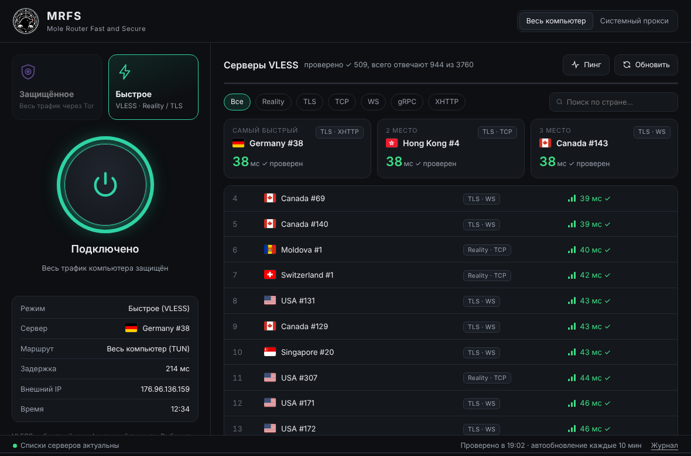

<p align="center"></p>

# MRFS — Mole Router Fast and Secure

Клиент для Windows 10/11, который пускает **весь компьютер** через защищённое соединение.
Бесплатные серверы и мосты берутся из открытых репозиториев на GitHub и обновляются автоматически.



## Два режима

| Режим | Что делает |
|---|---|
| **Защищённое** | Весь трафик через сеть **Tor** с мостами (obfs4, webtunnel, vanilla, snowflake). Максимальная анонимность. |
| **Быстрое** | Туннель **VLESS** (Reality / TLS; TCP, WS, gRPC, XHTTP, HTTPUpgrade) через Xray-core. |

Маршрут на выбор: **«Весь компьютер»** (виртуальный адаптер TUN через sing-box, нужны права администратора)
или **«Системный прокси»**.

## Возможности

- Списки серверов и мостов скачиваются из репозиториев ниже; каждые 10 минут MRFS проверяет новые коммиты
  и подхватывает изменения. Без интернета работает сохранённая копия.
- Один пинг при запуске (TLS-рукопожатие — его не подделает антивирус), серверы с пингом > 500 мс скрываются.
- Проверка настоящим запросом через каждый сервер: показываются только те, через которые реально идёт интернет (✓),
  самые быстрые — сверху. Рабочие серверы запоминаются на 3 дня и проверяются первыми.
- Вместо рекламных названий — страна выхода и номер с флагом («Germany #3»); серверы с выходом в России не показываются.
- Сворачивание в трей, журнал (`data\mrfs.log`).

## Источники

- [igareck/vpn-configs-for-russia](https://github.com/igareck/vpn-configs-for-russia) — папка `TOR-BRIDGES`
- [Delta-Kronecker/Tor-Bridges-Collector](https://github.com/Delta-Kronecker/Tor-Bridges-Collector) — папка `bridge`
- [zieng2/wl](https://github.com/zieng2/wl)
- [aviamastersgh/vpn-free-russia](https://github.com/aviamastersgh/vpn-free-russia)
- [terik21/HiddifySubs-VlessKeys](https://github.com/terik21/HiddifySubs-VlessKeys) — `main`, `WhiteKeys`, `WhiteKeys2`

Добавить свой источник — одна строка в [`sources.go`](sources.go).

## Установка

1. Скачайте архив `MRFS-win64.zip` из раздела **Releases** и распакуйте в любую папку.
2. Запустите `MRFS.exe` (попросит права администратора — для режима «Весь компьютер»).
3. Нужен Microsoft Edge WebView2 Runtime (в Windows 10/11 обычно уже есть).

> Антивирусы (например, Kaspersky) могут ругаться эвристикой на VPN-клиенты. Код открыт; при ложном
> срабатывании добавьте папку MRFS в доверенные программы.

## Сборка из исходников

Нужен Go 1.24+ (собирается и на Linux/macOS — кросс-компиляцией):

```sh
./build.sh          # → MRFS.exe
```

Рядом с `MRFS.exe` положите папку `core` с [Xray-core](https://github.com/XTLS/Xray-core/releases)
(`core\xray\xray.exe`) и [sing-box](https://github.com/SagerNet/sing-box/releases) 1.12 (`core\sing-box\sing-box.exe`) —
или программа скачает их сама при первом подключении. Tor (expert bundle) скачивается автоматически.

## Устройство

| Файл | Что внутри |
|---|---|
| `sources.go` | список репозиториев, отслеживание коммитов, кэш |
| `parse.go` | разбор мостов Tor и ссылок `vless://` → конфиг Xray |
| `ping.go`, `verify.go` | пинг и проверка серверов настоящим запросом |
| `app.go` | подключение, TUN / системный прокси, журнал |
| `cores.go`, `configs.go` | загрузка и конфиги Xray, sing-box, Tor |
| `main_windows.go`, `tray_windows.go`, `ui/` | окно (WebView2), трей, интерфейс |

## Благодарности и лицензии сторонних компонентов

- [Xray-core](https://github.com/XTLS/Xray-core) (MPL-2.0), [sing-box](https://github.com/SagerNet/sing-box) (GPL-3.0),
  [Tor](https://www.torproject.org/) (BSD-3) — запускаются как отдельные программы.
- Флаги — [lipis/flag-icons](https://github.com/lipis/flag-icons) (MIT).
- База IP → страна — [v2fly/geoip](https://github.com/v2fly/geoip) (CC-BY-SA-4.0).
- Окно — [jchv/go-webview2](https://github.com/jchv/go-webview2) (MIT).

## Важно

Бесплатные публичные серверы принадлежат третьим лицам: владелец VLESS-сервера видит, на какие сайты вы заходите.
Для важных аккаунтов используйте режим Tor или собственный сервер.
